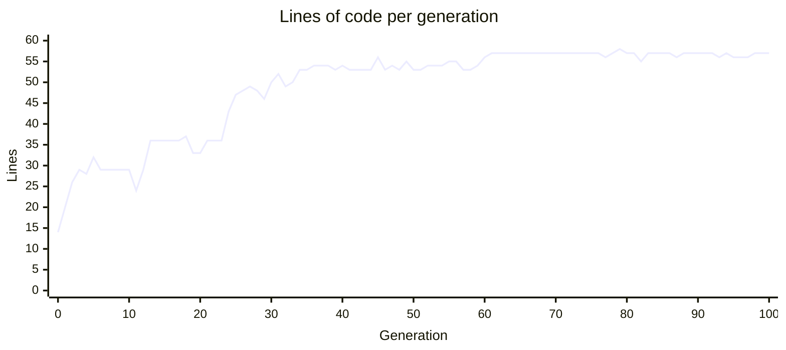
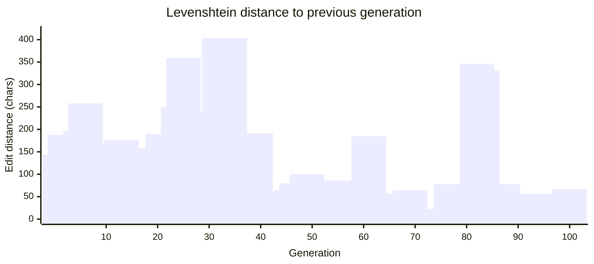
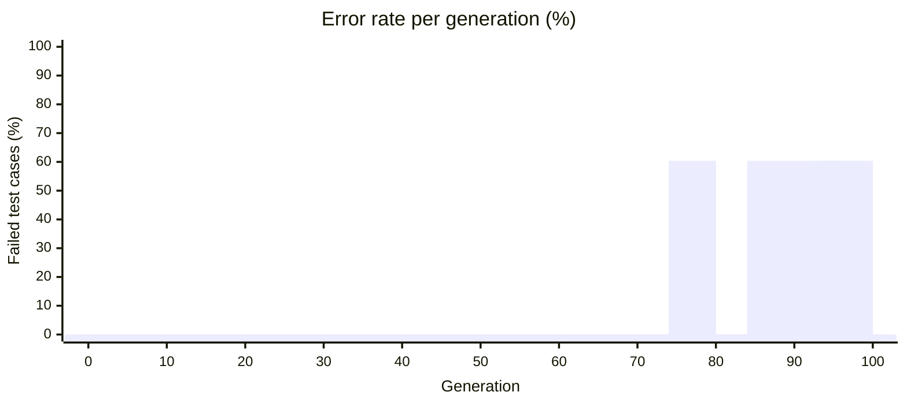

# AI Telephone

An experiment in what happens when you ask an LLM, over and over, to **"improve this"** code.

## The experiment

1. Start from [`basis.py`](basis.py): a correct, readable, 14-line bubble sort that stops early.
2. Send it to Claude with a single system prompt:

   > Improve the following Python code. Return nothing but the improved code. Do not add comments. Pure code only.

3. Save the answer as `generations/1.py`, send only that file back in, and repeat. The model sees just the latest version and nothing earlier.
4. Run for 100 generations ([`generations/1.py`](generations/1.py) … [`generations/100.py`](generations/100.py)).

There is no goal, no metric, and no stop condition, only "improve this". The question is what the model does when there is nothing left to improve.

## Running it

```sh
cp .env.example .env   # fill in AZURE_AI_ENDPOINT, AZURE_AI_KEY, AZURE_AI_STORY_DEPLOYMENT, GENERATIONS
make install
make run
```

[`telephone.py`](telephone.py) resumes from the highest-numbered file in `generations/`, so you can extend a run by raising `GENERATIONS`.

To check every generation for correctness:

```sh
python test-generation.py
```

## Results

### 1. Lines of code per generation

Generation 0 is [`basis.py`](basis.py).



The code grows from **14 to 57 lines (about 4x)** and then stops growing. The algorithm is the same bubble sort throughout. The extra lines come from a `Protocol` for `__lt__`, a bound `TypeVar`, `__all__`, `from __future__ import annotations`, cached `__getitem__`/`__setitem__` methods, `enumerate(map(...))` iterator tricks, `for … else` control flow, and a bidirectional ("cocktail") pass split across nested loops. None of it changes what the function does for a reader or caller.

### 2. Levenshtein distance between consecutive generations

Character-level edit distance from generation *n-1* to generation *n* (point 1 = `basis.py` → `1.py`).



### 3. Error rate per generation

Share of the 1,382 test cases in [`test-generation.py`](test-generation.py) that each generation sorts incorrectly. Generation 0 is [`basis.py`](basis.py). The cases cover edge cases (empty, single item, already sorted, reversed, duplicates, negatives, floats, strings), every permutation of 0–6 items, and 500 seeded random integer lists.



Generations 0–76 pass every case. Then six generations (**77, 87, 93, 95, 96, 97**) each fail **60.35%** of the cases. Those failures all come from one bug, described below.

### Phases

| Generations | What happens |
|---|---|
| 1–20 | Steady drift. Type hints, renames, micro-optimisations. Size goes from 14 to ~36 lines. |
| 21–40 | Large rewrites (spikes of 250–400 edits). The function becomes a cocktail-style sort built on iterators. Size goes to ~53 lines. |
| 41–60 | Settling down. The first exact back-to-back copies appear (41 = 42, 52 = 53). |
| **61–100** | **Loop.** Generation 61 becomes a fixed point that keeps coming back. |

### Where the repetition starts

From **generation 61** the model stops producing new code and cycles between a few variants that differ by 1–3 lines:

- [`61.py`](generations/61.py) is reproduced exactly at 63, 64, 65, 71, 73, 75, 78, 80, 83 and 100.
- [`77.py`](generations/77.py) recurs at 87, 93, 95 and 97. [`88.py`](generations/88.py) recurs at 89, 91, 92 and 94.
- 24 of the last 40 generations are byte-for-byte copies of an earlier generation.

The "improvements" just swap between equivalent ways of writing the same lines, for example:

```python
start = first_swap - 1 if first_swap else 0
start = max(first_swap - 1, 0)
start = first_swap and first_swap - 1
```

That is why the distance chart drops to near zero after generation 60: the model is still being asked to change something, so it toggles between these equivalent forms.

### "Improvements" that broke the code

Every generation was tested against `sorted()` with [`test-generation.py`](test-generation.py). Generations **77, 87, 93, 95, 96 and 97** are **wrong**:

```python
>>> bubble_sort([1, 0, 3, 2])
[3, 1, 2, 2]
```

The bug is a small "simplification" made to generation 61:

```diff
-                store(last, carried)
-                end = last
+                end -= 1
+                store(end, carried)
```

`end` has already been reassigned inside the inner loop, so `end -= 1` points to the wrong slot. The model then picks the broken variant up again in later generations, interleaved with correct ones.

## Takeaways

- With no goal, "improve this" leads to **more code, not better code**: 4x the lines for the same algorithm.
- The growth stops once the model runs out of things it can add, and the output settles into a **repeating loop around generation 61**.
- Inside that loop, the edits change only style, and some of them **introduce bugs** in code that started out correct.
